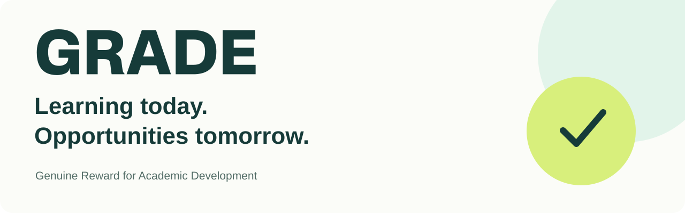

**[Website](https://grade.global/) · [App](https://thegrade.app/) · [Pilot and partnerships](https://grade.global/contact.html)**

GRADE — Genuine Reward for Academic Development — is developing a program that connects verified semester grades with opportunities after high school.

The program brings together students, families, schools, colleges and sponsors. Its aim is to recognise academic achievement, help students understand their strengths and support future college savings through participating partners.

GRADE is starting with a pilot. Visit the [official website](https://grade.global/) for current program details, participation information and partner terms, or explore [TheGradeApp](https://thegrade.app/).

For questions about the pilot, school participation, college partnerships or supporting GRADE, [contact the team](https://grade.global/contact.html).
